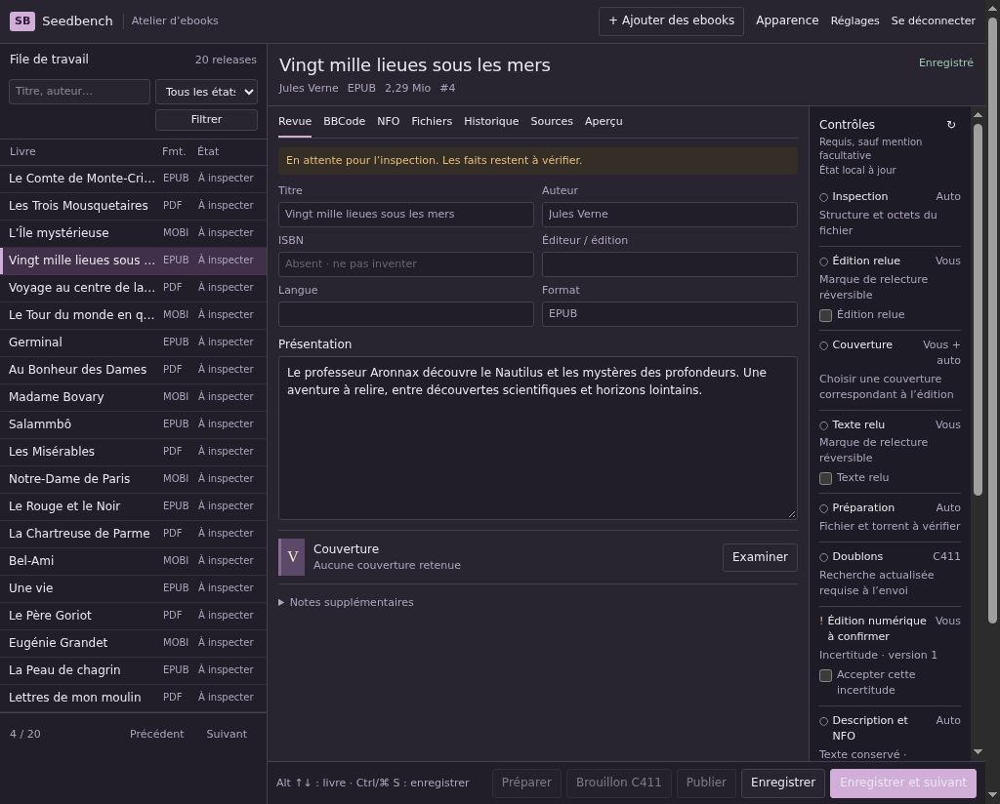

<h1 align="center">Seedbench</h1>

<p align="center">
  <strong>Your ebooks, ready for review.</strong><br>
  A self-hosted workbench for preparing ebook releases for C411.
</p>

<p align="center">
  <a href="https://github.com/01max/seedbench/actions/workflows/ci.yml"></a>
  <a href="#how-it-runs"></a>
  <a href="#features"></a>
</p>

<p align="center">
  <a href="#get-started"><strong>Get started</strong></a> ·
  <a href="#features">Explore features</a> ·
  <a href="docs/workbench.md">Workbench guide</a> ·
  <a href="#development">Development</a> ·
  <a href="#documentation">Documentation</a>
</p>

Bring your ebook files, reviewed metadata, and release text together in one
place. Work through a searchable queue, keep your edits between sessions, and
see which checks still need attention. The French interface supports dark and
light themes, compact desktop review, and narrower screens.

<p align="center">
  <a href="docs/images/workbench-dark.png"></a>
  <br>
  <sub>Actual application capture with synthetic data and public-domain book titles. Click to enlarge.</sub>
</p>

> [!NOTE]
> **Development preview.** Batch upload and persistent local review are available.
> Background ebook inspection and source-linked fact review are also available.
> Local BBCode/NFO generation and safe preview are available.
> Explicit canonical-file preparation and verified local torrents are available.
> Cover selection and read-only C411 duplicate search/review are available.
> Cover hosting is implemented at the remote-operation boundary.
> Optional evidence assessment and French prose suggestions are available.
> C411 drafts/publication and seeding are still being built.
> Draft and Publish are currently disabled.

## Features

| Feature | What you can do today |
| :--- | :--- |
| **Bring a batch** | Upload EPUB, PDF, or MOBI files: up to 50 per batch and 100 MiB per file. Each accepted file becomes its own release; individual errors leave the accepted files available. |
| **Find the next book** | Search titles and authors without worrying about accents or capitalization. Filter by state and navigate queues larger than a single page. |
| **Inspect without rewriting** | Background EPUB/PDF/MOBI inspection checks structure and extracts metadata, page or document counts, text samples, and cover candidates. Optional PDF OCR leaves the original untouched. |
| **Compare edition evidence** | Look up an ISBN in Open Library, compare source-linked candidates, and explicitly adopt reviewed facts. Checksum validity and digital-edition authenticity remain separate. |
| **Choose the cover** | Compare embedded and edition-linked images, select a local image or HTTPS URL, and retain its native dimensions, edition review and provenance without uploading it. |
| **Review C411 matches** | Search title variants, author and ISBN; compare edition/format evidence, confirm duplicates, and retain reasoned false-positive decisions. Failed or incomplete searches stay unresolved. |
| **Review in one place** | Edit metadata, presentation, notes, and complete BBCode/NFO. Open files, source evidence, history, and an escaped local prose preview when needed. |
| **Assemble release text** | Generate exact-template BBCode and factual NFO as reviewable proposals. Preview unsaved BBCode safely, keep full manual edits, and review text affected by changed facts or covers. |
| **Use optional assistance** | Request evidence-cited assessments and French presentation/notes, compare suggestions, and explicitly adopt them while preserving human BBCode/NFO. Continue manually when AI is disabled or unavailable. |
| **Prepare explicitly** | Review a release name, move the same file into the configured payload folder, and verify a private single-file torrent. Re-prepare after name changes; published names stay locked. |
| **Keep your edits** | Autosave while you work or use Save and next. Failed saves keep your text and selected book; concurrent edits require an explicit choice. |
| **Follow the checks** | Keep manual review marks with reversible history. Automatic checks reflect recorded observations, and uncertainty acknowledgements stay tied to their findings. |
| **Choose your workspace** | Use dark or light mode, switch tabs from the keyboard, and review on desktop or narrower screens. |
| **Configure connections** | Store encrypted C411, Deluge, OpenAI, and Postimages credentials. Run explicit connection checks that report exactly what they verified. |

Uploads retain the original bytes and queue bounded background inspection.
See [ebook inspection](docs/ebook-inspection.md) for sampling and resource limits. Saving or navigating never prepares a
torrent or writes to a provider. See the [workbench guide](docs/workbench.md)
for current behavior and limits. See [covers and duplicate review](docs/covers-and-duplicates.md) for image selection and C411 match handling. The [assistance guide](docs/ai-assistance.md) explains automatic requests, bounded evidence transfers, and explicit acceptance.

## Get started

Install **Docker Engine** and **Docker Compose 2.24.4 or newer**, using Linux
containers. Run the commands from a POSIX shell; on Windows, use WSL or a
compatible shell. Ruby, Node, SQLite, and ebook tools run inside containers.

```sh
git clone https://github.com/01max/seedbench.git
cd seedbench
bin/setup
bin/operator-password
bin/dev
```

Open **<http://127.0.0.1:3000>** and sign in with the password you set.
Setup builds the image and prepares the databases. The password command prompts
without echo. The default bind is loopback, and the app has one operator account.

### Your first review

1. **Add your ebooks.** Choose **Importer des ebooks** and select a batch. Review
   any individual upload errors; accepted files appear in the queue.
2. **Review the evidence.** Wait for inspection, then open **Sources** to compare
   extracted metadata and samples. Adopt verified values, look up an ISBN, or run
   optional PDF OCR. Fill in presentation, BBCode/NFO, and manual review marks.
3. **Prepare when ready.** Review **Nom de release**, use **Suggérer un nom** if
   needed, then **Préparer**. The [preparation guide](docs/payload-preparation.md)
   explains safe moves, local torrents, and recovery; this makes no remote write.
4. **Save and move on.** Use **Enregistrer et suivant** to save pending edits
   before selecting the next book. A failed save keeps you on the current one.

| Shortcut | Action |
| :--- | :--- |
| **Ctrl / Command S** | Save the current text immediately. |
| **Alt ↑ / ↓** | Save and select the previous / next matching book. |
| **← / → · Home / End** | Move between workspace tabs when a tab has focus. |

Provider accounts are optional for local review. Open **Réglages** when you want
to configure connections. Creating a connection saves configuration locally;
**Tester** runs its separate connection check. The
[provider guide](docs/provider-settings.md) describes each check's scope.

### Use your own folders

Named volumes work out of the box. To use existing host directories, declare
their paths in Compose configuration. State, scratch, and payload roots—as well
as the service UID/GID—are configurable. Web and worker share the same mounts;
Deluge's view of the payload folder can use a different container path.

<details>
<summary><strong>Configure bind mounts</strong></summary>

Copy the example configuration, then edit `compose.env` to set all three
`SEEDBENCH_*_SOURCE` values to existing host folders:

```sh
cp compose.env.example compose.env
```

Start with the bind-mount override enabled:

```sh
export SEEDBENCH_COMPOSE_ENV=compose.env
export COMPOSE_FILE=compose.yaml:compose.binds.yaml
bin/setup
bin/operator-password
bin/dev
```

The source folders must already exist and be accessible to the configured
UID/GID. Rebuild after changing container roots or service ownership. Existing
files keep their permissions; rebuilding does not change their ownership.
Deluge's configuration folders do not need to be mounted into Seedbench.

See [storage configuration](docs/storage-configuration.md) for path mapping,
permissions, upload-buffer capacity, and filesystem checks.

</details>

## How it runs

Seedbench uses **two long-running containers**, built from the same image:

| Service | Responsibility |
| :--- | :--- |
| **Web** | Rails, Hotwire, operator login, and the review workspace. |
| **Worker** | Active Job with Solid Queue, backed by a separate SQLite queue database. |

The application database also uses SQLite. State, scratch, and payloads live in
configured volumes or bind mounts. An existing Deluge instance connects through
its WebUI API; it is separate from these two services.

- **Files retain their identity.** Uploads create private staged copies and record
  the original filename, size, and SHA-256 without changing the supplied bytes.
- **Reviewed text has history.** Saved content and fact revisions persist across
  web/worker replacement. Unsaved browser drafts can be restored after reload,
  with an explicit conflict choice when the saved version has changed.
- **Credentials stay with your deployment.** Settings encrypts provider secrets.
  By default, the application secret and provider encryption key are initialized
  in the state volume; preserve them with your database backups.

Use `bin/compose down` to stop the stack while retaining its volumes. Application
commands select an explicit Compose environment file; an unrelated `.env` is
not loaded, and setup makes no provider calls. See
[operator access](docs/operator-access.md) and
[durable state](docs/domain-state.md) for session and recovery details.

## Development

Run the checks through Docker. The quality configuration uses disposable state,
synthetic fixtures, no operator mounts, and no external network.

| Command | Purpose |
| :--- | :--- |
| `bin/test` | Run the RSpec suite, including real Chromium browser checks. |
| `bin/test --seed 41327` | Reproduce a particular example order. |
| `bin/lint` | Run the configured RuboCop checks. |
| `bin/ci` | Check tests, coverage/lint enforcement, migrations, annotations, assets, tools, and actual container recovery. |
| `bin/annotate` | Refresh model schema comments with AnnotateRb after model or migration changes. |

GitHub Actions runs `bin/ci` on pull requests and pushes to `main`. Runtime checks
cover default named volumes, alternate roots and UID/GID, and bind paths
containing spaces. See [quality checks](docs/testing.md) and
[supported runtime](docs/runtime.md) for the verification details and tool versions.

Source changes require an image rebuild; `bin/dev` rebuilds and starts both
services. No host Ruby, Node, browser driver, or ebook-tool installation is needed.

## Documentation

| Looking for… | Start here |
| :--- | :--- |
| Upload limits, review, keyboard controls, and draft recovery | [Ebook workbench](docs/workbench.md) |
| Naming, canonical moves, private torrents, and interruption recovery | [Payload preparation](docs/payload-preparation.md) |
| Host mounts, path mapping, permissions, and scratch capacity | [Storage configuration](docs/storage-configuration.md) |
| Login, password reset, sessions, and HTTPS settings | [Operator access](docs/operator-access.md) |
| Credentials, defaults, and connection-check scope | [Provider settings](docs/provider-settings.md) |
| Service ownership and application boundaries | [Architecture](docs/architecture.md) |
| Revisions, history, and recoverable background work | [Durable state](docs/domain-state.md) |
| Test isolation, coverage, lint, and container checks | [Quality checks](docs/testing.md) |
| Supported dependencies and verification evidence | [Runtime](docs/runtime.md) |

## Help improve Seedbench

Found a bug or have an idea? [Open an issue](https://github.com/01max/seedbench/issues)
with the behavior you expected, what happened, and your Docker/storage setup.
Focused pull requests and documentation improvements are welcome.
